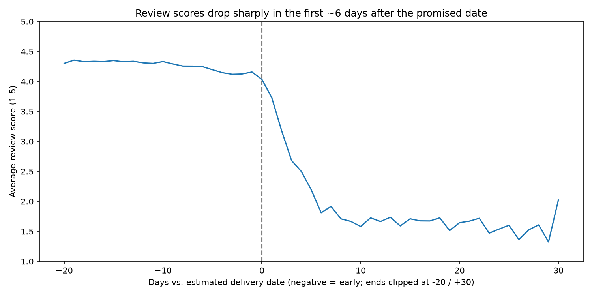
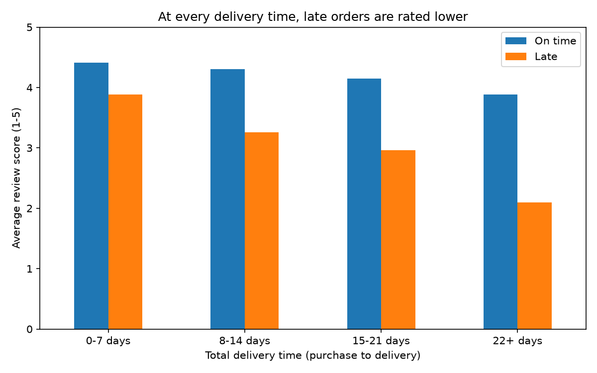

# Do late deliveries hurt customer reviews? (Olist e-commerce)

**Question:** How much does delivering after the estimated date lower customer review scores, and is it lateness or just long waiting?

**Data:** Olist Brazilian E-Commerce Public Dataset (Kaggle), ~99k orders, 2016-2018.
Dataset is not included; download it from Kaggle into `data/`. Check the dataset's license on its Kaggle page.

## Method
- Kept delivered orders with a delivery date and at least one review (95,824 of 96,478 delivered; 99.3%).
- Delay = actual delivery date minus estimated delivery date, in days.
- Review score averaged per order (some orders have several reviews).
- Compared scores by delay day, by total delivery time, and by customer state.

## Findings
- 6.7% of orders arrived after the estimated date. Their average score is 2.27, vs 4.29 for on-time orders.
- Scores fall steeply during the first ~6 days after the promised date (4.04 on the estimated day to ~1.8), then stay around 1.6.
- Orders arriving 8 or more days early are rated about 4.3; scores dip slightly (to ~4.1) for orders arriving only a few days early.
- Waiting alone costs some score: on-time orders drop from 4.41 (0-7 days) to 3.88 (22+ days). But at every delivery time, late orders score 0.5-1.8 points lower than on-time ones.
- The gap holds in each of the 10 largest states (late: 1.9-2.7, on time: 4.1-4.3), so region alone does not explain it.

## Limitations
- This shows an association, not proof of cause. Product category, seller and order size were not controlled for.
- Undelivered orders (3%, e.g. canceled or unavailable) are excluded and may be the worst experiences.
- Delay bins and the -20/+30 clipping are my choices; the clipped end points mix different delays.
- Beyond ~15 days late there are few orders per day, so those averages are noisy.
- Whether longer estimated dates would lower sales cannot be tested with this data.

## Charts



## Run
```
conda create -n olist python=3.12 pandas numpy matplotlib seaborn scikit-learn jupyter
jupyter notebook analysis.ipynb
```